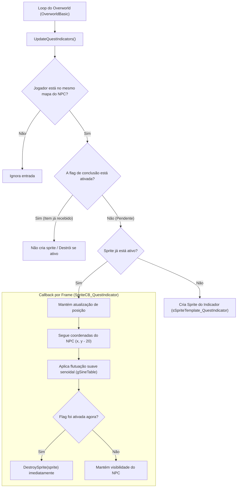

# Sistema de Indicadores de Missão (Quest Indicators)
**Projeto:** Pokémon Éclat Pourpre (pokeemerald)  
**Data:** 08/11/2026  

---

## 📌 Visão Geral

O **Sistema de Indicadores de Missão** (*Quest / Alert Indicators*) é um módulo modular e expansível criado para exibir balões visuais (como o ícone de exclamação `!`) flutuando sobre a cabeça de NPCs que possuem itens importantes, missões secundárias ou eventos pendentes para o jogador.

Assim que a condição é cumprida (ex: o jogador recebe o item e a flag correspondente é ativada), o ícone é **destruído em tempo real** e não volta a aparecer.

---

## 📂 Arquivos do Módulo

| Arquivo | Função |
| :--- | :--- |
| [`include/quest_indicator.h`](file:///C:/Users/raulr/OneDrive/Desktop/zEmerald/eclat-intro-teste/include/quest_indicator.h) | Declaração da interface pública (`UpdateQuestIndicators`). |
| [`src/quest_indicator.c`](file:///C:/Users/raulr/OneDrive/Desktop/zEmerald/eclat-intro-teste/src/quest_indicator.c) | Implementação da tabela de NPCs, template do sprite, callback com levitação senoidal e ciclo de vida. |
| [`src/overworld.c`](file:///C:/Users/raulr/OneDrive/Desktop/zEmerald/eclat-intro-teste/src/overworld.c#L1880-L1885) | Chamada de `UpdateQuestIndicators()` dentro do loop principal do Overworld (`OverworldBasic`). |

---

## ⚙️ Arquitetura e Ciclo de Vida



---

## 📋 Tabela de NPCs Ativos (`sQuestIndicators`)

Localizada no topo de [`src/quest_indicator.c`](file:///C:/Users/raulr/OneDrive/Desktop/zEmerald/eclat-intro-teste/src/quest_indicator.c#L20-L36):

```c
static const struct QuestIndicatorEntry sQuestIndicators[] =
{
    {
        .mapGroup = MAP_GROUP(MAP_LITTLEROOT_TOWN),
        .mapNum   = MAP_NUM(MAP_LITTLEROOT_TOWN),
        .localId  = 14, // Alda (Rio de Iviere Town)
        .flagId   = FLAG_GOT_EXP_SHARE_FROM_ALDA,
    },
    {
        .mapGroup = MAP_GROUP(MAP_IVIERE_FILAOS_HOUSE),
        .mapNum   = MAP_NUM(MAP_IVIERE_FILAOS_HOUSE),
        .localId  = 1,  // Mrs. Filão (Esposa do Professor)
        .flagId   = FLAG_IVIERE_TOWN_MAP_TAKEN,
    },
};
```

---

## 🚀 Como Adicionar Novos NPCs ao Sistema

Para adicionar um balão de exclamação a qualquer outro NPC em qualquer mapa do jogo, basta adicionar **uma nova entrada** no array `sQuestIndicators[]`:

1. Abra [`src/quest_indicator.c`](file:///C:/Users/raulr/OneDrive/Desktop/zEmerald/eclat-intro-teste/src/quest_indicator.c).
2. Adicione a entrada no formato:
   ```c
   {
       .mapGroup = MAP_GROUP(NOME_DO_MAPA),
       .mapNum   = MAP_NUM(NOME_DO_MAPA),
       .localId  = ID_LOCAL_DO_NPC, // Encontrado no map.json ou events.inc
       .flagId   = FLAG_QUE_DESATIVA_O_ICONE,
   },
   ```
3. Recompile com `./build.sh`. O NPC automaticamente terá o balãozinho até a flag ser ativada!

---

## 🎨 Características Visuais
- **Ícone**: O clássico balão de exclamação 16x16 pixels (`emotion_exclamation.png`) com borda preta e interior branco.
- **Paleta**: Utiliza a paleta global do overworld (`OBJ_EVENT_PAL_TAG_MAY`), compatível com todos os mapas sem consumir slots extras de paleta.
- **Animação**: Flutua suavemente para cima e para baixo ($\pm 2$ pixels) usando uma função trigonométrica contínua baseada em `gSineTable`.
